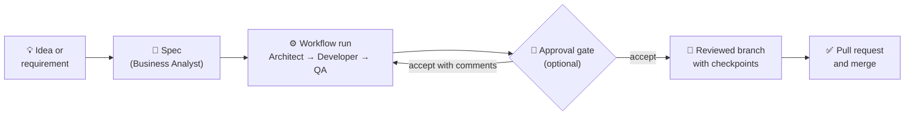
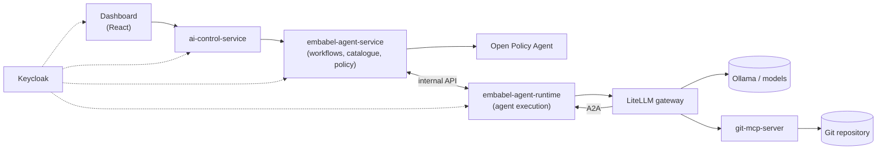

<p align="center">
  
</p>

<h3 align="center">The open-source AI Software Factory</h3>

<p align="center">
  <strong>Orchestrate AI agents. Govern development workflows. Build enterprise-grade software.</strong>
</p>

<p align="center">
  <a href="docs/readme/getting-started/quickstart.md">Getting started</a> ·
  <a href="docs/readme/README.md">Documentation</a> ·
  <a href="https://openjcockpit.github.io/OpenJCockpit/">Docs site</a> ·
  <a href="CONTRIBUTING.md">Contributing</a>
</p>

<p align="center">
  <a href="LICENSE"></a>
  <a href="https://github.com/OpenJCockpit/OpenJCockpit/actions/workflows/ci-summary.yml"></a>
  
</p>

---

**OpenJCockpit** is an open-source **AI Orchestration Dashboard and platform for governed agentic
software development**. Instead of one AI assistant writing code in isolation, OpenJCockpit runs
**teams of specialised AI agents** (business analyst, solution architect, software developer, QA
engineer) through **specification-driven workflows**, with **policy checks, human approval gates and
reviewable Git delivery** built in.

It is the orchestration and governance layer around agentic software engineering: you decide what gets
built, which agents may do what, and where a human must approve. The agents do the work in a branch you
review.

> **Status:** active development. Java application development is the primary focus. The repository
> ships a local Docker Compose stack for evaluation and development. It is not yet production-hardened;
> see [Known limitations](docs/readme/operations/known-limitations.md).

## Why OpenJCockpit?

Coding agents are good at producing code. Shipping software that a team can stand behind takes more:
clear requirements, a sound design, coordinated implementation, tests, review, policy and controlled
delivery. Without structure, AI-generated changes are hard to trust, hard to trace and hard to govern.

OpenJCockpit brings these activities together:

- **From AI-assisted coding** → **to orchestrated AI software engineering**
- **From individual agents** → **to coordinated development workflows**
- **From unstructured prompting** → **to specification-driven engineering**
- **From autonomous code generation** → **to governed, reviewable delivery**

## What makes it different

| | |
| --- | --- |
| **🧭 AI agent orchestration** | Compose workflows from a catalogue of role-based agents that run in order, each building on the previous agents' output. Chain workflows, group them and queue specs per project. → [Agents and workflows](docs/readme/workflows/agents-and-workflows.md) |
| **📐 Specification-driven development** | Specs with requirements and acceptance criteria live in your repository and are the input contract for implementation workflows. → [Spec-driven development](docs/readme/workflows/spec-driven-development.md) |
| **🛡️ Governed agentic AI** | Every workflow start, agent and tool call is evaluated by [Open Policy Agent](https://www.openpolicyagent.org/). Tools are granted server-side only, guardrails fail closed, and decisions are audited. → [Policy enforcement](docs/readme/governance/policy-enforcement.md) |
| **🙋 Human-in-the-loop control** | Approval gates pause a run after a chosen agent: accept, deny, or accept with comments to send the agent back with feedback (bounded). → [Approval gates](docs/readme/governance/approval-gates.md) |
| **🔧 Policy-controlled tool execution** | Agents reach Git through an MCP server behind a gateway. Tool scope comes from the run, not the LLM, and Git credentials never pass through an LLM. → [MCP tools](docs/readme/integrations/mcp-tools.md) |
| **🌿 Reviewable Git-based delivery** | Each run works on its own branch with a checkpoint commit per agent, so your team reviews agent work with its normal pull-request process. → [Git integration](docs/readme/workflows/git-integration.md) |
| **🧩 Extensible, open architecture** | Agents are Markdown definitions or [A2A](https://a2a-protocol.org/) agents. Models are aliases behind a LiteLLM gateway, and policies are Rego files. Apache 2.0 licensed. → [Architecture](docs/readme/concepts/architecture.md) |

## How it works



1. **Describe** a feature in a prompt. *Create spec from prompt* has the Business Analyst agent turn it
   into a small, testable spec in your repository.
2. **Run** a workflow on that spec. *Implement spec* chains the Solution Architect, Software Developer
   and QA Engineer agents; *Realise spec (code)* adds the Business Analyst in front. OPA checks the start
   and every tool call.
3. **Decide** at approval gates, if you added them: accept, deny, or send the agent back with comments.
4. **Review** the result: a dedicated Git branch with the agents' changes and a checkpoint commit for
   each agent's output. Open the pull request and merge through your usual process.

Runs that are not bound to a repository record the agents' outputs on the run instead of writing files.
Default workflows do not open pull requests or merge on their own. → [Default workflows](docs/readme/workflows/agents-and-workflows.md#default-workflows-automatically-imported)

## The AI Orchestration Dashboard

The dashboard is where engineers and leads coordinate AI-driven development:

- **Select a project** and its repository, and manage Git credentials.
- **Design workflows**: pick agents from the catalogue (local or A2A), order them, and add approval gates
  and workflow orbs. Group workflows, then export or import them as JSON.
- **Run and observe**: start workflows (with a prompt when needed), follow agents live, read their
  outputs, events and policy decisions, and see the resulting branch.
- **Decide**: review the approval context, including changed files, and accept, deny or comment.
- **Manage specs and queues**: browse specs, initialise the spec structure, create specs from prompts and
  queue specs per project.
- **Explore skills and agents** in the Skills Hub and agent catalogue.

→ [Dashboard overview](docs/readme/concepts/overview.md#the-ai-orchestration-dashboard)

## Example: adding a feature to a Java application

Your team maintains a Spring Boot service and needs a *leave request approval* feature.

1. In the dashboard you select the project. You click **✨ Create spec with prompt** and describe the
   feature. The Business Analyst agent drafts a spec with acceptance criteria, and you review it.
2. You start **Implement spec** on the new spec. The Solution Architect proposes the design. The Software
   Developer reads the relevant code and writes the changes and tests in the run's branch. The QA
   Engineer checks them against the acceptance criteria.
3. An approval gate you added after the developer lets your tech lead read the changed files and send the agent back
   once with *"use the existing audit service"*.
4. The run finishes with a branch containing the code, tests and every agent's output as checkpoint
   commits. Your team opens a pull request, CI runs, and a human merges it.

Every step is visible, policy-checked and traceable in Git.

## Getting started

**Prerequisites:** Docker with Docker Compose, [Ollama](https://ollama.com) running on the host with
`qwen3.6:27b` pulled, and an **OpenAI API key** (required to boot; some model aliases and embeddings use
OpenAI).

```bash
ollama pull qwen3.6:27b              # on the host; keep Ollama running
cp .env.example .env                 # then set OPENAI_API_KEY in .env
docker compose up --build
```

Open **http://localhost:4000** and sign in with a seeded local user (for example `tony` / `Welkom01!`).
All seeded credentials are **local-development-only** examples.

→ Full guide: [Quickstart](docs/readme/getting-started/quickstart.md) ·
[LLM setup](docs/readme/integrations/llm-providers.md) ·
[Authentication](docs/readme/getting-started/authentication.md) ·
[Troubleshooting](docs/readme/operations/troubleshooting.md)

## Architecture



| Layer | Technology |
| --- | --- |
| Dashboard | React 19, Vite, TypeScript, Nx, Keycloak JS |
| Orchestration and control | Java 25, Spring Boot 4.1, [Embabel](https://github.com/embabel/embabel-agent) agent framework, Spring AI |
| Agents and tools | Markdown agent definitions, A2A 0.3, Model Context Protocol (Git/GitHub via JGit) |
| Models | LiteLLM gateway, local Ollama (`qwen3.6:27b`), OpenAI |
| Governance and identity | Open Policy Agent (Rego), Keycloak, PostgreSQL audit and state |

OpenJCockpit is **Java-first**: it is built in Java and focused on Java application development. Agents,
skills and tools are configuration that operates on repository files, so other languages are a natural
extension point. They are not yet a verified target. → [Architecture](docs/readme/concepts/architecture.md)

## Documentation

| Goal | Read |
| --- | --- |
| **Understand the platform** | [Overview](docs/readme/concepts/overview.md) · [Architecture](docs/readme/concepts/architecture.md) · [Agent runtime](docs/readme/concepts/agent-runtime.md) |
| **Start using it** | [Quickstart](docs/readme/getting-started/quickstart.md) · [Authentication](docs/readme/getting-started/authentication.md) · [LLM providers](docs/readme/integrations/llm-providers.md) |
| **Build with agents** | [Agents and workflows](docs/readme/workflows/agents-and-workflows.md) · [Spec-driven development](docs/readme/workflows/spec-driven-development.md) · [Agents and A2A](docs/readme/integrations/a2a-agents.md) · [Spec queue](docs/readme/workflows/spec-queue.md) · [Git integration](docs/readme/workflows/git-integration.md) |
| **Configure governance** | [Policy enforcement](docs/readme/governance/policy-enforcement.md) · [Approval gates](docs/readme/governance/approval-gates.md) · [Security considerations](docs/readme/governance/security-considerations.md) |
| **Extend the platform** | [MCP tools](docs/readme/integrations/mcp-tools.md) · [Skills Hub](docs/readme/integrations/skills-marketplace.md) · [Local development](docs/readme/development/local-development.md) |
| **Operate and troubleshoot** | [Runbooks](docs/readme/operations/runbooks.md) · [Troubleshooting](docs/readme/operations/troubleshooting.md) · [Known limitations](docs/readme/operations/known-limitations.md) · [Configuration reference](docs/readme/reference/configuration-reference.md) |
| **Contribute** | [Contributing](CONTRIBUTING.md) · [Testing](docs/readme/development/testing.md) · [CI](docs/readme/development/continuous-integration.md) · [Dependency updates](docs/readme/operations/dependency-management.md) |

Looking for a section of the previous README? See the
[documentation migration map](docs/readme/reference/documentation-migration-map.md).

For AI assistants, [`llms.txt`](llms.txt) gives a compact project summary and a curated index of
these documents.

## Security and current limitations

OpenJCockpit is designed to support governed AI-driven software engineering. The stack in this
repository is a **local development environment**: it uses publicly known seed credentials, exposes the
Docker daemon to a service, and has only coarse-grained authorization, among other limitations. Do not
deploy it to a shared or production environment without your own assessment and hardening.

- [Security considerations](docs/readme/governance/security-considerations.md)
- [Known limitations](docs/readme/operations/known-limitations.md)
- Found a vulnerability? Please report it privately; see [SECURITY.md](SECURITY.md).

## Community and contributing

OpenJCockpit is open source under the [Apache License 2.0](LICENSE) (see also [NOTICE](NOTICE)).
Contributions are welcome: bug reports, ideas for agents and workflows, documentation and code.

- Read the [contribution guide](CONTRIBUTING.md) and the [Code of Conduct](CODE_OF_CONDUCT.md).
- Report bugs or propose features in [GitHub Issues](https://github.com/OpenJCockpit/OpenJCockpit/issues).
- Set up your environment with [Local development](docs/readme/development/local-development.md).

If OpenJCockpit is useful to you or you like the direction, **try it, share feedback, and give the
project a ⭐ on GitHub**. It helps others discover governed agentic software development.
