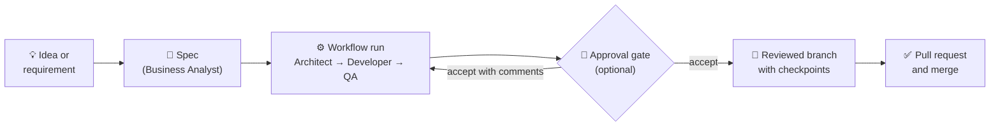

<p align="center">
  
</p>

<h3 align="center">The open-source AI Software Factory</h3>

<p align="center">
  <strong>You are the pilot. AI is your crew. Quality is the destination.</strong>
</p>

<p align="center">
  <a href="docs/readme/getting-started/quickstart.md">Getting started</a> ·
  <a href="docs/readme/README.md">Documentation</a> ·
  <a href="https://openjcockpit.github.io/OpenJCockpit-docs/">Docs site</a> ·
  <a href="CONTRIBUTING.md">Contributing</a>
</p>

<p align="center">
  <a href="LICENSE"></a>
  <a href="https://github.com/OpenJCockpit/OpenJCockpit/actions/workflows/ci-summary.yml"></a>
  
</p>

---

**OpenJCockpit** is an open-source **AI Orchestration Dashboard and platform for governed agentic
software development**. Instead of one AI assistant writing code in isolation, it runs **teams of
specialised AI agents** (business analyst, solution architect, software developer, QA engineer) through
**specification-driven workflows**, with **policy checks, human approval gates and reviewable Git
delivery** built in. You decide what gets built, which agents may do what, and where a human must
approve. The agents do the work in a branch you review.

> **Status:** active development. Java application development is the primary focus. The repository
> ships a local Docker Compose stack for development and production profiles for Kubernetes and VM/VPS
> ([Production runbook](docs/readme/operations/production-runbook.md),
> [Security review](docs/readme/governance/security-review.md)). Read the
> [Known limitations](docs/readme/operations/known-limitations.md) before deploying.

## How it works



Every workflow start and tool call is checked by [Open Policy Agent](https://www.openpolicyagent.org/),
humans approve at gates you choose, and each run delivers a Git branch with a checkpoint commit per
agent. Default workflows never open pull requests or merge on their own.
→ [Overview](docs/readme/concepts/overview.md) · [Architecture](docs/readme/concepts/architecture.md)

## Quickstart

**Prerequisites:** Docker with Docker Compose, [Ollama](https://ollama.com) on the host and an
**OpenAI API key**. The [Quickstart](docs/readme/getting-started/quickstart.md) lists the model to pull and
the seeded local sign-in.

```bash
cp .env.example .env                 # then set OPENAI_API_KEY in .env
docker compose up --build            # backend stack
git clone https://github.com/OpenJCockpit/OpenJCockpit-frontend.git ../OpenJCockpit-frontend \
  && cd ../OpenJCockpit-frontend && docker compose up --build   # dashboard on http://localhost:4000
```

Pull the Ollama model first and keep Ollama running; the exact steps are in the
[Quickstart](docs/readme/getting-started/quickstart.md).

## Documentation

**Which doc do I read?**

- **Learn by doing:** guided tutorials on the [docs site](https://openjcockpit.github.io/OpenJCockpit-docs/).
- **Look something up:** the [documentation index](docs/readme/README.md) (also published as Reference on the docs site).
- **Contribute:** [CONTRIBUTING.md](CONTRIBUTING.md).
- **AI assistants:** [`llms.txt`](llms.txt).

## Security and current limitations

OpenJCockpit is designed to support governed AI-driven software engineering. The stack in this
repository is a **local development environment**: it uses publicly known seed credentials, exposes the
Docker daemon to a service, and has only coarse-grained authorization, among other limitations. Do not
deploy it to a shared or production environment without your own assessment and hardening.

- [Security considerations](docs/readme/governance/security-considerations.md)
- [Known limitations](docs/readme/operations/known-limitations.md)
- Found a vulnerability? Please report it privately; see [SECURITY.md](SECURITY.md).

## Community and contributing

OpenJCockpit is open source under the [Apache License 2.0](LICENSE) (see also [NOTICE](NOTICE)).
Contributions are welcome: bug reports, ideas for agents and workflows, documentation and code.

- Read the [contribution guide](CONTRIBUTING.md) and the [Code of Conduct](CODE_OF_CONDUCT.md).
- Report bugs or propose features in [GitHub Issues](https://github.com/OpenJCockpit/OpenJCockpit/issues).
- Set up your environment with [Local development](docs/readme/development/local-development.md).

If OpenJCockpit is useful to you or you like the direction, **try it, share feedback, and give the
project a ⭐ on GitHub**. It helps others discover governed agentic software development.
