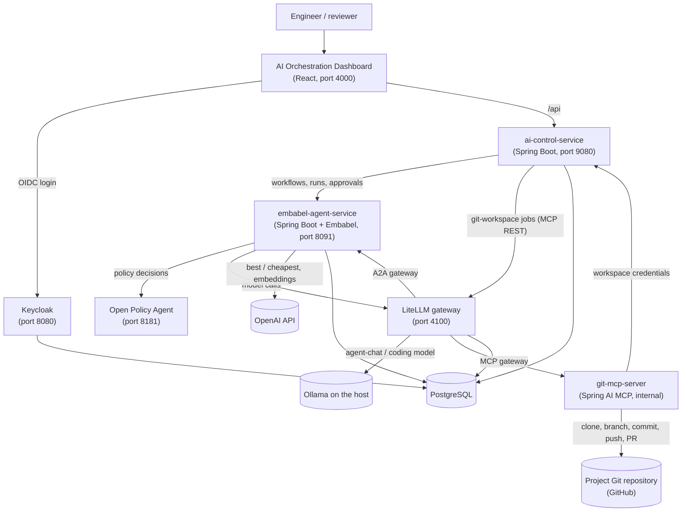
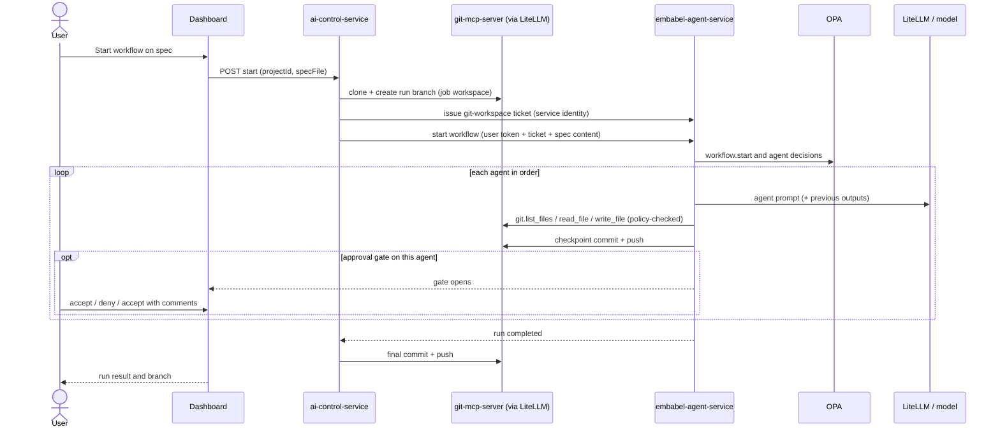

# Architecture

OpenJCockpit is a set of Java services and a React dashboard, run together with Docker Compose. The
design separates **orchestration** (workflows and agents), **control** (projects, credentials, queues,
jobs), **tools** (Git via MCP), **model access** (a LiteLLM gateway), **policy** (OPA) and **identity**
(Keycloak).

## System overview

## Components

| Component | Responsibility | Technology |
| --- | --- | --- |
| **Dashboard** (`frontend/apps/dashboard`) | The AI Orchestration Dashboard: one shell app composing Nx feature libraries (`project`, `workflow`, `spec-files`, `spec-queue`, `skills-hub`, `api`, `auth`, `ui`, `landing-hub`). | React 19, Vite, TypeScript, Nx, TanStack Query, React Router, `keycloak-js` |
| **`ai-control-service`** | Dashboard-facing API and proxy; projects and encrypted Git credentials; spec files and spec-init; spec queue runner; git-workspace jobs (clone, branch, final push); start enrichment (selected spec content). | Java 25, Spring Boot 4.1, PostgreSQL |
| **`embabel-agent-service`** | Workflow engine: workflow definitions and groups, agent catalogue, configuration-driven agents, A2A endpoint and provider clients, OPA policy client, approval gates, run state, outputs, checkpoints, audit trails. | Java 25, Spring Boot 4.1, [Embabel](https://github.com/embabel/embabel-agent) agent framework, Spring AI, PostgreSQL |
| **`git-mcp-server`** | Git and GitHub tools over MCP (SSE), per-run/per-job workspaces, server-side credential resolution. Not published on the host. | Java 25, Spring AI MCP server, JGit |
| **`service-common`** | Shared Java code. | Java |
| **LiteLLM** | Model gateway (aliases to local Ollama), A2A gateway for the seeded agents, MCP gateway in front of `git-mcp-server`; virtual keys per caller. | LiteLLM proxy |
| **OPA** | Policy decisions for workflow starts, agents, skills and tool calls. | Open Policy Agent, Rego |
| **Keycloak** | User login (custom theme), realm roles, service clients. | Keycloak 26 |
| **PostgreSQL** | Keycloak, `openjcockpit`, `embabel` and `litellm` databases. | PostgreSQL 16 |
| **`docker-socat`** | Exposes the Docker daemon to `ai-control-service` for workflow containers. Local development only. | socat |

Contracts between the dashboard and services are described in
[`shared/contracts/openapi.yaml`](../../../shared/contracts/openapi.yaml).

## Architectural ideas that matter

- **The workflow is the only execution engine.** Every run starts through a workflow, so every run goes
  through the same policy checks, gates, audit and Git handling.
- **Agents are configuration, not code.** Agents are Markdown definitions (local) or A2A agents behind a
  gateway. New roles, skills and even new languages can be added without changing the engine.
- **Tools are granted server-side and checked at call time.** Neither prompts nor skills can grant a
  tool; tool scope (repository, workspace) comes from the run, not from the LLM.
- **Credentials stay server-side.** Git credentials are resolved by `git-mcp-server` from
  `ai-control-service`, never passed through LiteLLM or an LLM.
- **One gateway for model, agent and tool traffic.** LiteLLM provides per-caller virtual keys and
  permissions for models, A2A agents and the Git MCP server.
- **Git as the delivery and audit medium.** Each run works on its own branch, with a checkpoint commit per
  agent, so humans review agent work with their normal tools.
- **Ports and adapters.** Git and GitHub operations sit behind `GitWorkspaceOperations` and
  `GitHubOperations` ports; LLM providers sit behind model aliases.

## Request flow: a workflow run on a project

## Java first, extensible beyond Java

The platform is implemented in Java and currently targets Java application development. Because agents,
skills and tools are configuration and operate on repository files, other languages are an
extensibility opportunity. See [Overview](overview.md#java-first-language-extensible-by-design).

## Related

- [Overview](overview.md)
- [Agents and workflows](../workflows/agents-and-workflows.md)
- [MCP tools](../integrations/mcp-tools.md)
- [LLM providers](../integrations/llm-providers.md)
- [Security considerations](../governance/security-considerations.md)
