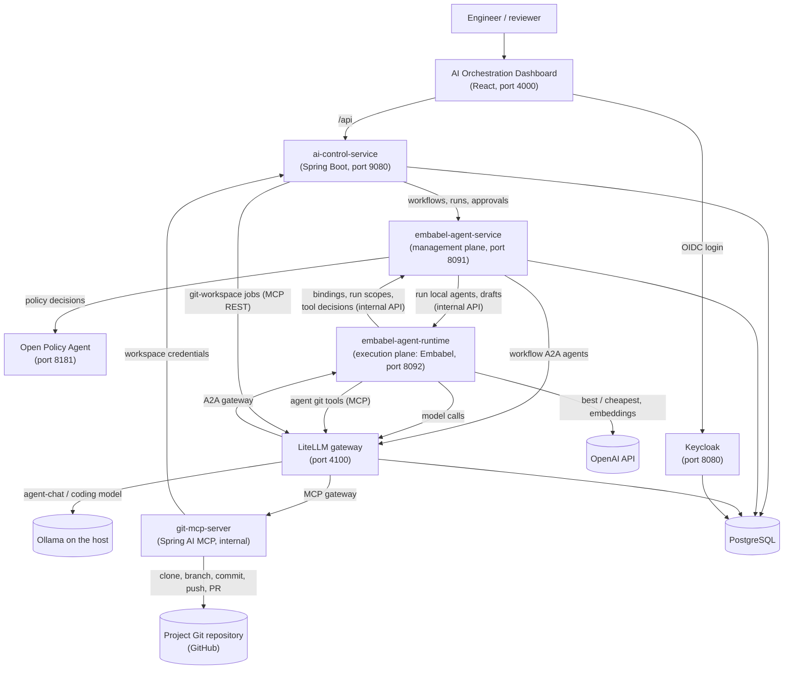
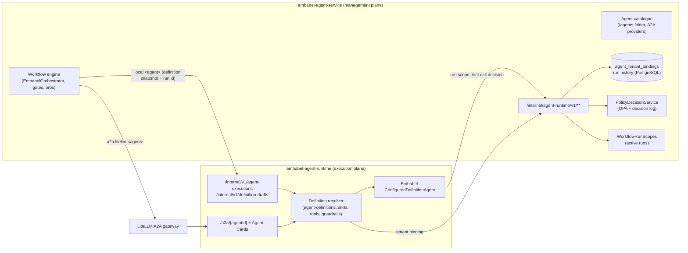

# Architecture

OpenJCockpit is a set of Java services and a React dashboard, run together with Docker Compose. The
design separates **orchestration** (workflows and agent management), **agent execution** (the Embabel
runtime), **control** (projects, credentials, queues, jobs), **tools** (Git via MCP), **model access** (a
LiteLLM gateway), **policy** (OPA) and **identity** (Keycloak).

## System overview



## Components

| Component | Responsibility | Technology |
| --- | --- | --- |
| **Dashboard** (`frontend/apps/dashboard`) | The AI Orchestration Dashboard: one shell app composing Nx feature libraries (`project`, `workflow`, `spec-files`, `spec-queue`, `skills-hub`, `api`, `auth`, `ui`, `landing-hub`). | React 19, Vite, TypeScript, Nx, TanStack Query, React Router, `keycloak-js` |
| **`ai-control-service`** | Dashboard-facing API and proxy; projects and encrypted Git credentials; spec files and spec-init; spec queue runner; git-workspace jobs (clone, branch, final push); start enrichment (selected spec content). | Java 25, Spring Boot 4.1, PostgreSQL |
| **`embabel-agent-service`** | Management plane: workflow definitions and groups, workflow orchestration (sequential agent chain, approval gates, workflow orbs), agent catalogue, tenant bindings, outbound A2A provider clients, OPA policy decisions and decision log, run state, outputs, checkpoint commits, audit trails. Runs no agent and no LLM itself. | Java 25, Spring Boot 4.1, PostgreSQL |
| **`embabel-agent-runtime`** | Execution plane: the [Embabel](https://github.com/embabel/embabel-agent) agent platform, configuration-driven agent definitions (shipped in its image), definition resolution, skills, tool binding and agent git tools, guardrails, LLM routes, inbound A2A endpoints and Agent Cards, definition drafts. No database. | Java 25, Spring Boot 4.1, Embabel, Spring AI |
| **`git-mcp-server`** | Git and GitHub tools over MCP (SSE), per-run/per-job workspaces, server-side credential resolution. Not published on the host. | Java 25, Spring AI MCP server, JGit |
| **`service-common`** | Shared Java code: security configuration, client-credentials tokens, the agent-definition Markdown contract and the agent service ↔ runtime contract (`nl.metafactory.common.agentruntime`). | Java |
| **LiteLLM** | Model gateway (aliases to local Ollama), A2A gateway for the seeded agents, MCP gateway in front of `git-mcp-server`; virtual keys per caller. | LiteLLM proxy |
| **OPA** | Policy decisions for workflow starts, agents, skills and tool calls. | Open Policy Agent, Rego |
| **Keycloak** | User login (custom theme), realm roles, service clients. | Keycloak 26 |
| **PostgreSQL** | Keycloak, `openjcockpit`, `embabel` (owned by `embabel-agent-service`) and `litellm` databases. | PostgreSQL 16 |
| **`docker-socat`** | Exposes the Docker daemon to `ai-control-service` for workflow containers. Local development only. | socat |

Contracts between the dashboard and services are described in
[`shared/contracts/openapi.yaml`](../../../shared/contracts/openapi.yaml).

## Management plane and execution plane

`embabel-agent-service` and `embabel-agent-runtime` are two independent processes and images. They share no
Spring context, database, volume or in-process object; everything crosses an explicit, authenticated HTTP
contract (`nl.metafactory.common.agentruntime`, both directions Keycloak client credentials, authorised by
`azp`, failing closed).



| Concern | Owner | How the other side gets it |
| --- | --- | --- |
| Workflow definitions, runs, history, gates, orbs, checkpoints | agent service | — (runtime never sees workflow data beyond a run's scope) |
| Agent catalogue (`/agents`) | agent service | definition snapshot in each execution request |
| Tenant bindings (`agent_tenant_bindings`, Flyway) | agent service | `GET /internal/agent-runtime/v1/tenants/{t}/agent-bindings/{a}` |
| Scope of an active run (workflow, git workspace) | agent service | `GET /internal/agent-runtime/v1/workflow-runs/{runId}` |
| OPA tool-call decision + decision log | agent service | `POST /internal/agent-runtime/v1/tool-invocation-decisions` |
| Served agent definitions and skills (`agent-definitions/`) | runtime (in its image) | — |
| Embabel, LLM routes, tools, guardrails, A2A inbound | runtime | `POST /internal/v1/agent-executions`, LiteLLM A2A |
| Execution lifecycle (accepted ids, status) | runtime (in memory) | `GET /internal/v1/agent-executions/{id}` |

See [Agent runtime](agent-runtime.md) for the contract, security model and failure semantics, and
[Remote agent runtime](../operations/remote-agent-runtime.md) for running the runtime on another host.

## Architectural ideas that matter

- **The workflow is the only execution engine.** Every run starts through a workflow, so every run goes
  through the same policy checks, gates, audit and Git handling.
- **Management and execution are separate deployables.** The workflow engine decides *what* runs; the agent
  runtime runs it. The runtime can move to another host by configuration alone.
- **Agents are configuration, not code.** Agents are Markdown definitions (local) or A2A agents behind a
  gateway. New roles, skills and even new languages can be added without changing the engine.
- **Tools are granted server-side and checked at call time.** Neither prompts nor skills can grant a
  tool; tool scope (repository, workspace) comes from the run, not from the LLM.
- **Credentials stay server-side.** Git credentials are resolved by `git-mcp-server` from
  `ai-control-service`, never passed through LiteLLM or an LLM.
- **One gateway for model, agent and tool traffic.** LiteLLM provides per-caller virtual keys and
  permissions for models, A2A agents and the Git MCP server.
- **Git as the delivery and audit medium.** Each run works on its own branch, with a checkpoint commit per
  agent, so humans review agent work with their normal tools.
- **Ports and adapters.** Git and GitHub operations sit behind `GitWorkspaceOperations` and
  `GitHubOperations` ports; LLM providers sit behind model aliases.

## Request flow: a workflow run on a project

```mermaid
sequenceDiagram
    actor User
    participant Dash as Dashboard
    participant AC as ai-control-service
    participant Git as git-mcp-server (via LiteLLM)
    participant EA as embabel-agent-service
    participant RT as embabel-agent-runtime
    participant OPA
    participant LLM as LiteLLM / model
    User->>Dash: Start workflow on spec
    Dash->>AC: POST start (projectId, specFile)
    AC->>Git: clone + create run branch (job workspace)
    AC->>EA: issue git-workspace ticket (service identity)
    AC->>EA: start workflow (user token + ticket + spec content)
    EA->>OPA: workflow.start and agent decisions
    loop each agent in order
        EA->>RT: run agent (definition snapshot or via LiteLLM A2A; run id only)
        RT->>EA: tenant binding, run scope
        RT->>LLM: agent prompt (+ previous outputs)
        RT->>EA: tool-call decision (OPA, audited)
        RT->>Git: git.list_files / read_file / write_file
        RT-->>EA: agent output
        EA->>Git: checkpoint commit + push
        opt approval gate on this agent
            EA-->>Dash: gate opens
            User->>Dash: accept / deny / accept with comments
        end
    end
    EA-->>AC: run completed
    AC->>Git: final commit + push
    Dash-->>User: run result and branch
```

## Java first, extensible beyond Java

The platform is implemented in Java and currently targets Java application development. Because agents,
skills and tools are configuration and operate on repository files, other languages are an
extensibility opportunity. See [Overview](overview.md#java-first-language-extensible-by-design).

## Related

- [Overview](overview.md)
- [Agent runtime](agent-runtime.md)
- [Agents and workflows](../workflows/agents-and-workflows.md)
- [MCP tools](../integrations/mcp-tools.md)
- [LLM providers](../integrations/llm-providers.md)
- [Security considerations](../governance/security-considerations.md)
