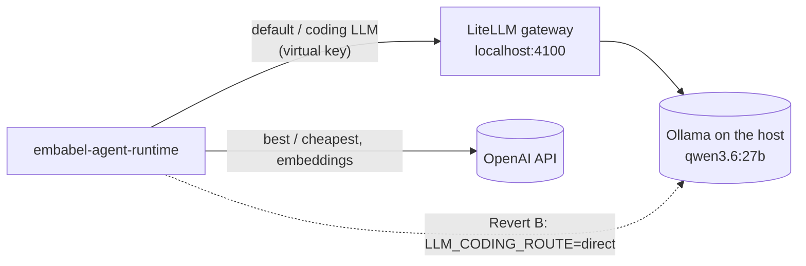

# LLM providers: Ollama, LiteLLM and OpenAI

OpenJCockpit's agents call large language models through configurable model aliases. In the local
stack, three providers are involved:

| Route | Provider | Used for |
| --- | --- | --- |
| Default/coding LLM and agent model aliases (`agent-chat`, `customer-chat`) | Local **Ollama** model (`qwen3.6:27b`), reached through the **LiteLLM gateway** | Every agent's main LLM calls. |
| `best` / `cheapest` aliases and embeddings | **OpenAI** (called directly, not proxied) | Remaining OpenAI-hosted calls. `OPENAI_API_KEY` is mandatory to boot the stack. |
| Direct Ollama (optional, *Revert B*) | Host Ollama, bypassing LiteLLM | Incident fallback, configuration only. |

This is **not** an "all-local" mode, and **not** an "everything through one gateway" setup: both
OpenAI and the local model are in use.

## Local Ollama Qwen model (prerequisite, before you start the stack)

The agent pipeline's default LLM (`embabel-agent-runtime`) runs on a locally
hosted Qwen model served by **Ollama on your host machine**. Ollama is
**not** part of the Docker Compose stack. You install and run it yourself,
before `docker compose up`:

1. [Install Ollama](https://ollama.com) on the host machine.
2. Pull the model tag: `ollama pull qwen3.6:27b`.
3. Keep the Ollama daemon running for the whole time the stack is up. The
   pipeline calls it on every agent run.

**Networking defaults: host-run vs. Compose-run.** The default Ollama base
URL depends on how `embabel-agent-runtime` itself is running:

| Mode                                             | Default `OLLAMA_BASE_URL`           |
| ------------------------------------------------ | ----------------------------------- |
| Host-run (e.g. `mvn spring-boot:run`, no Docker) | `http://localhost:11434`            |
| Compose-run (inside `docker compose up`)         | `http://host.docker.internal:11434` |

Two environment variables control this, both overridable in `.env`:

| Variable          | Default                                                                             | Meaning                                                   |
| ----------------- | ----------------------------------------------------------------------------------- | --------------------------------------------------------- |
| `OLLAMA_BASE_URL` | `http://localhost:11434` (host-run) / `http://host.docker.internal:11434` (Compose) | Base URL of the Ollama daemon.                            |
| `OLLAMA_MODEL`    | `qwen3.6:27b`                                                                       | The Ollama model tag to use; must exist in `ollama list`. |

In `docker-compose.yml` both values are defined once (YAML anchors) and shared by the `litellm` and
`embabel-agent-runtime` containers.

**Caveat:** `OLLAMA_BASE_URL` in `.env` applies to the **container**, not your
host. Setting `OLLAMA_BASE_URL=http://localhost:11434` in `.env` breaks the
containerized `embabel-agent-runtime`, because nothing listens on the
container's own loopback interface. Only override it if your Ollama daemon
listens somewhere other than the Compose default.

> **Warning: Linux hosts.** The Compose container reaches Ollama via
> `host.docker.internal`. On Docker Desktop (macOS/Windows) this resolves to
> the host's default `127.0.0.1`-bound Ollama automatically. On **Linux**,
> `host.docker.internal` arrives on a non-loopback host interface, so Ollama
> must be bound wider than `127.0.0.1`, e.g. `OLLAMA_HOST=0.0.0.0`. Doing this
> **exposes an unauthenticated LLM endpoint to your local network**: anyone
> on the same network could submit prompts and consume your GPU. Prefer a
> narrower bind (the `docker0`/bridge interface address) or firewall port
> `11434` instead of binding to all interfaces.

**Health is not readiness for inference.** `/actuator/health` reports `UP`
even when Ollama is unreachable. No model pull or availability probe is
attempted at startup, by design. The first sign of a problem will be an LLM
call failing at run time, not a failing health check.

## LiteLLM gateway

The agent pipeline's default/coding LLM routes through a **LiteLLM
gateway container** at host URL `http://localhost:4100`. The container
internally listens on port `4000`, but the host mapping is `4100` because
port `4000` is already used by the `dashboard` service. The host Ollama
prerequisite is **unchanged**: Ollama is still not a Compose service, still
installed and run on the host, still `ollama pull qwen3.6:27b`.

Besides model routing, the same LiteLLM instance also acts as:

- the **A2A gateway** for the seeded agents (see [A2A agents](a2a-agents.md)), and
- the **MCP gateway** in front of `git-mcp-server` (see [MCP tools](mcp-tools.md)).

`infrastructure/litellm/config.yaml` is the single source of truth for the model list and runtime
policy (timeouts, no retries, message-logging redaction). See
[`infrastructure/litellm/README.md`](../../../infrastructure/litellm/README.md) for what it pins and why.

The following environment variables control the LiteLLM gateway. All are
defined in `.env.example` (commented out by default) and overridable in
`.env`:

| Variable               | Default                              | Meaning                                                                 |
| ---------------------- | ------------------------------------ | ----------------------------------------------------------------------- |
| `LITELLM_MASTER_KEY`   | `sk-openjcockpit-litellm-local`       | The LiteLLM proxy admin/master API key.                                 |
| `LITELLM_SALT_KEY`     | `sk-openjcockpit-litellm-salt-local`  | LiteLLM's encryption salt key. Changing it invalidates stored credentials. |
| `LITELLM_VIRTUAL_KEY`  | `sk-openjcockpit-embabel-local`       | The virtual key `embabel-agent-runtime` presents to the gateway.        |
| `LITELLM_A2A_KEY`      | `sk-openjcockpit-a2a-local`           | The one LiteLLM A2A client key (catalog, agent cards, calling agents).  |
| `LITELLM_AI_CONTROL_KEY` | `sk-openjcockpit-ai-control-local`  | LiteLLM key of `ai-control-service`: MCP REST bridge and the Git MCP server only. |
| `LITELLM_UI_USERNAME`  | `ricky`                              | LiteLLM admin UI username.                                              |
| `LITELLM_UI_PASSWORD`  | `Welkom01!`                          | LiteLLM admin UI password.                                              |
| `LLM_CODING_ROUTE`     | unset (commented out)                | Set to `direct` to bypass the gateway and call the host Ollama daemon directly (Revert B, see below). |

The non-admin virtual keys are created by the idempotent `local-seed` one-shot on every
`docker compose up`.

**Verifying the gateway path end to end.** An automated, live Playwright
check proves a real agent LLM call actually transits this gateway to host
Ollama and is attributed to the expected virtual key and model: run
`npm run e2e:llm` from `frontend/e2e/`. It requires the full stack running (LiteLLM,
`embabel-agent-runtime`, host Ollama with the configured model pulled, plus
Keycloak/`ai-control-service`/`dashboard`). See [`frontend/e2e/README.md`](../../../frontend/e2e/README.md)'s
"The agent ⇄ LiteLLM ⇄ Ollama live check" section for the exact
preconditions, strict-mode flag, and what it does and does not prove.

> **Warning: local-only credentials.** `ricky`/`Welkom01!` and every LiteLLM
> gateway key listed above are **local-testing-only seed credentials**. They
> must never be reused in CI, staging, or production.

**Non-Keycloak auth gap.** The LiteLLM admin UI on port `4100` is a second
authentication surface backed by LiteLLM's own internal credential store,
not Keycloak. This is an accepted, documented local-development-only gap,
the same posture already used elsewhere in this repo for `docker-socat`
and `git-mcp-server`. Vendor admin-UI accessibility is explicitly out of
scope.

**Worst-case call durations.** One default-LLM call has a worst-case
duration of up to **600 seconds**; one full agent action including its
data-binding re-ask has a worst-case duration of up to **1200 seconds**,
identical to the pre-gateway direct-Ollama path, because the gateway adds
no additional retry multiplication. If the gateway container itself is
down, a call fails in under **45 seconds** per attempt (about **90 seconds**
including the re-ask). A wrong or missing virtual key fails closed in well
under **1 second** total, but as **two** gateway requests, not one, bounded
by `embabel.agent.platform.llm-operations.data-binding.max-attempts=2` (not
an unbounded retry loop). See [Known limitations](../operations/known-limitations.md) for
why this is two requests instead of one.

A whole workflow run can take much longer than one call. Locally, `ai-control-service` waits up to
`WORKFLOW_AGENT_TIMEOUT` (default `3600` seconds in Compose) for a run, because several agents on the
local model with Git tool calls take well over the 600-second service default.

## Reverting the default LLM

**Revert A: to OpenAI.** There is no automatic fallback between providers.
To move the default LLM back to `gpt-4.1-mini`, use either form:

- Environment variable (no rebuild): `EMBABEL_MODELS_DEFAULT_LLM=gpt-4.1-mini`
- `application.yml` edit: `embabel.models.default-llm: gpt-4.1-mini`

This is unchanged and still works precisely because OpenAI is not proxied
through the gateway. **This revert is not automatic**; it requires a
manual step.

**Revert B: to direct host Ollama.** Add `LLM_CODING_ROUTE=direct` to
`.env`, then run `docker compose up -d embabel-agent-runtime`. No rebuild,
no code edit and no `docker-compose.yml` edit is needed. **This revert is not
automatic**; it requires a manual step. Caveat: the `litellm` service's
`depends_on: ... service_healthy` condition on `embabel-agent-runtime`
still applies, so the `litellm` container must still start even though it
will not be called when `LLM_CODING_ROUTE=direct`. Removing that dependency
would itself be a `docker-compose.yml` edit, which is explicitly out of
scope here.

> **Verification note: check that the variable reaches the container.** Both reverts are configured
> through environment variables read by `embabel-agent-runtime`'s `application.yml`
> (`openjcockpit.llm.coding.route: ${LLM_CODING_ROUTE:gateway}`, and Spring's relaxed binding for
> `EMBABEL_MODELS_DEFAULT_LLM`). In the current `docker-compose.yml`, the `embabel-agent-runtime` service
> has no `env_file` and does not list `LLM_CODING_ROUTE` or `EMBABEL_MODELS_DEFAULT_LLM` under
> `environment`, and `.env` is only used by Compose for variable interpolation. As the files stand,
> adding these variables to `.env` alone therefore does **not** appear to reach the container; the
> variable must be present in the service's environment (which is a `docker-compose.yml` change) or set
> when running the service on the host. Verify with
> `docker compose exec embabel-agent-runtime env | grep -E "LLM_CODING_ROUTE|EMBABEL_MODELS"` before
> relying on either revert during an incident.

## Release notes

**Release note (local Ollama default).** This changes the default LLM for **every** agent in the
pipeline (at the time of that change: requirement analysis, impact, test design, implementation,
review, realisation, evidence, prompt-to-definition), not only code generation. The
`best`/`cheapest` aliases and embeddings **remain OpenAI-hosted**; this is
not an "all-local" mode. `OPENAI_API_KEY` **remains mandatory** to boot the
stack. This change makes the pipeline cheaper to _run_, not cheaper to
_start_.

> The list of agents in the release note above describes the built-in pipeline as it existed when
> the change was made. That pipeline has since been replaced by catalogue agents; see
> [Agents and workflows](../workflows/agents-and-workflows.md) and
> [Historical notes](../reference/historical-notes.md).

**Release note (LiteLLM gateway).** The default/coding LLM now has a hard
dependency on the `litellm` gateway container. A developer who previously
ran the stack with direct host Ollama must now also run the `litellm`
gateway container. The `best` and `cheapest` LLM aliases and embeddings
still call OpenAI directly (not proxied), so this is explicitly **not** an
"everything through one gateway" change. `OPENAI_API_KEY` remains mandatory
to boot the stack. Both revert paths (A and B above) are manual, never
automatic. The Micrometer/metrics provider tag for default-LLM calls changes
from the Ollama naming convention to the OpenAI naming convention now that
calls are proxied through LiteLLM's OpenAI-compatible endpoint, so
`/actuator/metrics` series names/tags for that call path shift accordingly.
All LiteLLM gateway credentials listed in the variable table above are
local-testing-only.

## LiteLLM data and `docker compose down -v`

`docker compose stop`/`start` and a plain `docker compose down` (without
`-v`) preserve the LiteLLM `ricky` admin account, the virtual key, and
usage history in the `litellm` Postgres database. `docker compose down -v`
additionally destroys the LiteLLM database state along with Keycloak state,
since the `postgres` service declares no separately-scoped named volume for
litellm data.

## Related

- [A2A agents](a2a-agents.md): agents served over the LiteLLM A2A gateway.
- [MCP tools](mcp-tools.md): the Git MCP server behind LiteLLM.
- [Known limitations](../operations/known-limitations.md): LiteLLM retry behaviour and MCP tool-call fidelity.
- [Configuration reference](../reference/configuration-reference.md).
