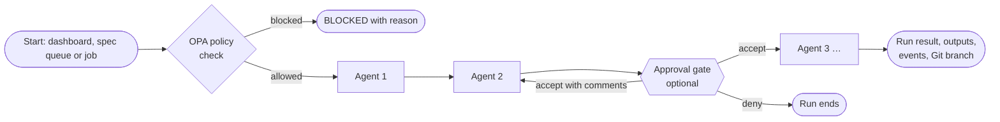

# Agents and workflows

A **workflow** is the unit of orchestration in OpenJCockpit: an ordered chain of catalogue agents,
plus optional approval gates and workflow orbs, which you design and start from the AI
Orchestration Dashboard (**Workflow Design & Execution**). The workflow is the only execution
engine: every run starts through a workflow, either from the dashboard
(`POST /api/workflows/{id}/start`), from the [spec queue](spec-queue.md), or from a git-workspace job
that starts a workflow.

## How a workflow run executes



- **Agent references.** A workflow refers only to agents in the central
  [agent catalogue](../integrations/a2a-agents.md): `local:<agent-id>` (repository folder `/agents`)
  or `a2a:<provider>:<agent>` (for example `a2a:litellm:qa-engineer`). In the API/YAML DTO the
  field is still called `agentIds`. The link table `workflow_agent_refs` (`workflow_id`, `position`,
  `source`, `provider`, `agent_id`) is the single source of truth.
- **Sequential execution with context.** Agents run in order. Each agent receives the workflow input
  plus the outputs of the previous agents, within a budget of
  `openjcockpit.agent-workflows.max-message-chars` (default 30 000 characters; the oldest outputs are
  dropped first).
- **Recorded outputs.** Each output is recorded as a run event (first 1 900 characters). Full outputs
  per agent are stored (up to 1 MB per agent) and available via `GET /api/agent-runs/{runId}/outputs`.
- **Policy first.** Before a run starts, OPA evaluates the workflow start and every agent. Agents
  denied by policy are excluded; if all are denied, the start is `BLOCKED`. See
  [Policy enforcement](../governance/policy-enforcement.md).
- **Human-in-the-loop.** An approval gate can be anchored to an agent reference. *Accept with
  comments* re-runs that agent with the feedback and its previous output (at most 3 iterations by
  default). See [Approval gates](../governance/approval-gates.md).
- **Git workspace.** When a run starts on a project with a repository, all agents of the run share
  one Git workspace and branch, with a checkpoint commit after every agent. See
  [Git integration](git-integration.md).

### Refusals at the write and start boundaries

| Situation | Result |
| --- | --- |
| Create/update/import a workflow with no linked agent | HTTP 400: `At least one agent must be linked to workflow '<id>'.` |
| The same agent linked twice | HTTP 400: `An agent can be linked only once per workflow ('<id>').` |
| A workflow without a group and without a project | HTTP 400 (see [project assignment](#project-assignment-and-visibility)) |
| An approval gate anchored to an agent that is not in the workflow | HTTP 400: `Approval gate placement stage '<stage>' is not among this workflow's selected agents: [...]` |
| Start a workflow with no agents linked | `BLOCKED`: `Workflow '<id>' has no agents linked; link agents from Workflow design → Agents in Design → Workflows.` |
| Start a workflow where every agent is denied by policy | `BLOCKED`: `All agents of workflow '<id>' were denied by policy; nothing to run.` |
| Start with an invalid, expired or foreign git-workspace ticket | `BLOCKED`: `The git workspace ticket is invalid, expired or not issued for this workflow and user` |

## Default workflows (automatically imported)

On startup, `embabel-agent-service` automatically imports a default workflow bundle
([`spec-workflow/default-workflows.json`](../../../services/embabel-agent-service/src/main/resources/spec-workflow/default-workflows.json))
with the global group **Spec-driven development** and four workflows. They use the four seeded
agents served through the LiteLLM A2A gateway:

| Workflow | Id | Agents (in order) | Purpose |
| --- | --- | --- | --- |
| Spec folder initialization | `wf-spec-init` | Solution Architect | Proposes the repository's spec structure (spec folder layout and a spec template) for agentic workflows. The output is recorded on the run. |
| Create spec from prompt (RAG) | `wf-spec-create` | Business Analyst | Turns a prompt into a small, executable spec (requirements and acceptance criteria) that the implementation workflow can pick up in a single run. Asks for a prompt on start. |
| Implement spec | `wf-spec-implement` | Solution Architect → Software Developer → QA Engineer | The architect designs the change, the developer proposes the code changes with tests, the QA engineer verifies them against the acceptance criteria. |
| Realise spec (code) | `wf-spec-realise` | Business Analyst → Solution Architect → Software Developer → QA Engineer | Full delivery chain from requirements to verification, each agent building on the previous outputs. |

What these workflows produce depends on how they are started:

- **Started on a project with a repository** (the normal dashboard flow): the run works in its own
  Git branch, the Software Developer and QA Engineer can write files there (`git.write_file`), and
  every agent's output is committed as a checkpoint. The result is a **reviewable branch** pushed to
  your repository. See [Git integration](git-integration.md).
- **Started without a project or repository:** the agents' outputs are recorded on the run only;
  their Git tools report that no repository is bound, and agents describe the changes instead.

The default workflows **do not open a pull request or merge anything by themselves**, and none has an
approval gate configured out of the box. Add a gate in Workflow Design if you want a human decision
inside the run.

The import is idempotent: records are only added if their id does not yet exist, so your own changes
to these workflows are preserved. Disable it with
`openjcockpit.workflow-definitions.seed-defaults=false`. To deliberately re-import the defaults, use
`./scripts/stack-clean-start.sh` (a scoped reset of only the workflow and workflow-group seed data).

> **Historical note.** Earlier versions shipped a built-in pipeline (requirement, impact, test design,
> implementation, review, realisation, evidence) in which *Implement spec* produced only a plan and
> *Realise spec (code)* wrote code and opened a pull request. That pipeline was removed when workflows
> moved to catalogue agents. The original description is preserved in
> [Historical notes](../reference/historical-notes.md).

## Prompt-driven workflows

The **Create spec from prompt (RAG)** workflow has `promptRequired: true`: when started, the
dashboard asks for a prompt in a dialog (in the same futuristic house style). The prompt and/or the
selected spec file are sent as a JSON body to `POST /api/workflows/{id}/start`
(`{ "prompt": "...", "specFile": "..." }`); an explicit prompt takes priority over the selected spec
file as the payload for the agent run. The _Ask for prompt on start_ field in Workflow Design enables
this behaviour on custom workflows.

Workflows also have a **promptInstructions** field: instructions that are prepended to the user prompt
when starting. For _Create spec from prompt (RAG)_, these contain the full instructions for the agent:
create a branch (`spec/<NNN-feature-slug>`), create the spec based on
`.specify/templates/spec-template.md`, update `specs/_index.md`, keep the spec small enough for a single
implementation run, and commit and push the branch to origin so a pull request can be opened. Custom
prompt workflows can fill in their instructions via _Prompt instructions (prefix)_ in Workflow Design.

> Whether the agent can carry out the Git steps in those instructions depends on its tools: the seeded
> Business Analyst has read-only Git tools (`git.list_files`, `git.read_file`). When the run is bound
> to a project workspace, its output is committed by the workspace checkpoint mechanism instead.

**Selected spec as agent input.** For dashboard starts, the dashboard sends only the file name of the
selected spec. `ai-control-service` reads that spec from the project repository's `specs/` folder and
passes `# Spec: specs/<name>` plus its content as workflow input, so agents do not need Git tools to
read the spec. If the name is unknown or the repository is unreadable, the name is passed on unchanged
(the start does not fail). The input counts towards the message budget (at most one third, 10 000
characters at the default).

## Workflow Design: groups and JSON export/import

Workflows in the Workflow Design & Execution screen can be bundled into **workflow
groups**: logical groups for workflows with a shared meaning (for example
onboarding, compliance, or reporting).

- Manage groups via the **Groups** tab in Workflow Design (create, edit, delete).
- Link a workflow to a group via the **Group** field in the workflow form, and
  filter the workflow table by group via the group filter in the toolbar.
- Deleting a group unlinks the associated workflows; the workflows themselves
  continue to exist.
- The workflow editor picks agents per catalogue section (Local / LiteLLM) and shows the execution
  order with ↑/↓; the gate and orb drop-downs list the linked agents in that order.

### Project assignment and visibility

- Both workflows and groups can be linked to a project (field _Project name_).
- A workflow **without a group must** have a project; a workflow **with a group may**
  be project-less. Workflows without a group and without a project are rejected (400), both
  on create/edit and on JSON import.
- Which project a workflow "sees": the workflow's own project wins; if that is empty,
  the group's project applies. If that is also empty, the workflow is **global** and
  available for every project. This is how the default workflows from the global group
  _Spec-driven development_ can be started for any project, both from the dashboard and
  manually from the Overview tab.

### Export and import

Workflows and groups can be exported and imported together as JSON, for example
to move them between environments:

- **⬇ Export JSON** in the Workflows tab downloads `workflow-export.json` containing
  `{ "groups": [...], "workflows": [...] }`.
- **⬆ Import JSON** reads that same format back in. Records are upserted by `id`;
  records without an `id` automatically get a generated id. Import checks agent references for
  syntax only; references are re-checked when the workflow starts.

The underlying endpoints (proxied by the `ai-control-service` to the
`embabel-agent-service`):

```text
GET    /api/workflow-groups            # list of groups
POST   /api/workflow-groups            # create a group
PUT    /api/workflow-groups/{id}       # update a group
DELETE /api/workflow-groups/{id}       # delete a group (unlinks workflows)
GET    /api/workflows/export           # exports groups + workflows as a JSON bundle
POST   /api/workflows/import           # imports a previously exported bundle
```

Workflow definitions are stored as YAML files in the `workflow-definitions` volume
(`WORKFLOW_DEFINITIONS_PATH`); agent references are stored in PostgreSQL. Pre-catalogue workflow YAML
that still contains old stage ids loads without agents and must be re-linked in the designer.

## Workflow chaining (workflow orbs)

A workflow can contain **workflow orbs**: anchored to one of its agents, an orb triggers another
workflow as a child. Orb-child workflows do not inherit the parent's Git workspace.

`embabel-agent-service` exposes four environment-overridable tunables for workflow chaining,
following the `${VAR:-default}` convention:

| Variable                                  | Default | What it bounds                                                                                                                                 |
| ------------------------------------------ | ------- | ------------------------------------------------------------------------------------------------------------------------------------------------ |
| `WORKFLOW_TRIGGER_SEQUENTIAL_MAX_WAIT`     | `30m`   | The maximum time a SEQUENTIAL parent waits for its child workflow to finish before the parent times out.                                       |
| `WORKFLOW_TRIGGER_MAX_CHAIN_DEPTH`         | `3`     | The maximum chain depth. A cost and blast-radius control: each additional chain level multiplies LLM calls, git operations, and pull requests. |
| `WORKFLOW_TRIGGER_MAX_ORBS_PER_WORKFLOW`   | `5`     | The maximum number of workflow orbs allowed on a single workflow definition.                                                                    |
| `WORKFLOW_TRIGGER_ENABLED`                 | `true`  | Runtime kill switch for the whole workflow-trigger feature.                                                                                      |

This timeout is deliberately unrelated to `ExecutionConfig.timeoutSeconds`, which is dead
configuration: persisted and exposed in the API contract but never read by any code.

## Run visibility in the dashboard

- Run status, events and agent outputs per run; execution history per workflow
  (`GET /api/workflows/{workflowId}/executions`).
- Policy decision logs per workflow and per execution (`/decision-logs` endpoints).
- Approval-gate context and decisions per run (`/api/agent-runs/{runId}/approval-gate`,
  `/approval-decisions`).
- An unknown or expired run id surfaces as a terminal **"run state lost"** outcome rather than an endless
  "waiting" indicator. See [Approval gates](../governance/approval-gates.md#deliberate-behaviour-change-1-unknown-run-ids-now-surface-as-run-state-lost-not-an-endless-waiting-poll).

## Related

- [Spec-driven development](spec-driven-development.md)
- [Spec queue](spec-queue.md)
- [Git integration](git-integration.md)
- [Approval gates](../governance/approval-gates.md)
- [Runbooks](../operations/runbooks.md): workflow definition file logging.
