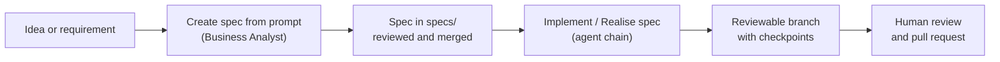

# Specification-driven development

OpenJCockpit treats a **specification as an executable contract**: a feature is specified, with
requirements and acceptance criteria, before an agent plans or implements it. Specs live as Markdown
in the project's Git repository, so they are versioned, reviewable and shared by humans and agents
alike.

There are two related layers:

1. **Specs in your project repositories**: the specs the dashboard lists for a project, created and
   consumed by the default workflows.
2. **The spec-driven workflow for OpenJCockpit's own agentic development**: the folder rules and
   templates in `services/embabel-agent-service/`.

## Specs in your project repositories



### Spec-init and create flows in the dashboard

Without specs, the dashboard shows one of two flows depending on the repository state:

- **No `.specify` folder on the base branch** → the spec-init flow: a starter template
  is offered as a pull request (or the link to an already open spec-init branch).
- **A `.specify` folder exists, but no specs yet in `specs/`** → the pull-request flow is
  skipped and the dashboard shows the **✨ Create spec with prompt** button, which starts the
  _Create spec from prompt (RAG)_ workflow via the prompt dialog. The status endpoint
  (`GET /api/projects/{id}/spec-init/status`) reports this via the `templateExists` field.

The starter spec template that `ai-control-service` pushes is
[`services/ai-control-service/src/main/resources/spec-workflow/spec-template.md`](../../../services/ai-control-service/src/main/resources/spec-workflow/spec-template.md).
Once specs exist, select one in the dashboard and start a workflow on it; the selected spec's content
is passed to the agents as workflow input. See
[Agents and workflows](agents-and-workflows.md#prompt-driven-workflows).

A local example spec repository with two fictional customers is mounted read-only into
`ai-control-service` from
[`infrastructure/spec-repository-stub/`](../../../infrastructure/spec-repository-stub/) (`SPEC_REPOSITORY_PATH`).

## Spec-driven workflow for OpenJCockpit's agentic development

All agentic AI feature work follows a spec-driven workflow. The structure, templates, and rules
live in `services/embabel-agent-service/` (see also
[`services/embabel-agent-service/AGENTS.md`](../../../services/embabel-agent-service/AGENTS.md)).

### Initialize the spec workflow

The structure is automatically created and validated on startup of the
`embabel-agent-service` (`SpecWorkflowInitializer`, can be disabled with
`SPEC_WORKFLOW_INIT_ENABLED=false`). The same validation runs as a JUnit test on every build:

```bash
mvn -pl services/embabel-agent-service test
```

### Spec folder rules

- Every feature must have its own folder under `specs/`.
- The folder name must match `NNN-feature-slug`.
- Every feature folder must contain `spec.md`, `plan.md`, `tasks.md`, and `review.md`.
- The only Markdown file allowed directly in `specs/` is `_index.md`.
- Flat spec files are forbidden.

Templates for new features are located in
[`services/embabel-agent-service/templates/specs/`](../../../services/embabel-agent-service/templates/specs/).
Copy them to `specs/NNN-feature-slug/` and update `specs/_index.md`. An example feature is
[`specs/001-example-feature/`](../../../services/embabel-agent-service/specs/001-example-feature/).

### Human approval rules for agents

`AGENTS.md` requires an agent to stop and ask for human approval when, among other things, a spec
declares personal data together with a public-cloud LLM strategy, contains secrets, requires a DPIA,
or when the task mutates customer data, sends external messages, or changes authentication,
authorization, logging, retention or data exports. Agents must not send secrets, credentials, tokens,
production data, special category data or raw personal data to public LLMs. See the full list in
[`AGENTS.md`](../../../services/embabel-agent-service/AGENTS.md).

> These are rules for agents working under that workflow. Runtime enforcement in the platform comes
> from OPA policies, tool allowlists, guardrails and approval gates; see
> [Policy enforcement](../governance/policy-enforcement.md).

## Verification commands

Backend and frontend verification commands are listed in
[Local development](../development/local-development.md#verification).

## Related

- [Agents and workflows](agents-and-workflows.md)
- [Spec queue](spec-queue.md): run specs one after another per project.
- [Git integration](git-integration.md)
